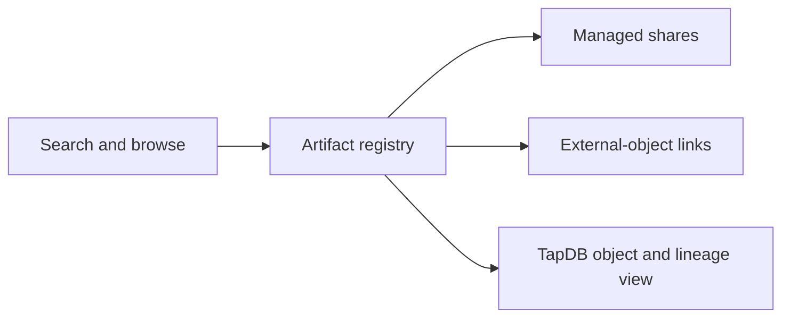

<p align="center">
  <strong>Dewey</strong><br>
  Artifact, reference, share, and external-object registry for Dayhoff.
</p>

<p align="center">
  <a href="docs/apis.md">API</a> ·
  <a href="docs/gui.md">GUI</a> ·
  <a href="docs/architecture.md">Architecture</a> ·
  <a href="docs/sequencer_run_registration.md">Run registration</a>
</p>

## Overview

Dewey is the LSMC artifact and reference registry. It tracks durable artifacts such as sequencing run directories, VCFs, reports, external objects, external-object relations, managed shares, and access routes. It is the registry layer for data products and referenceable outputs, not the laboratory material graph.

Current Dayhoff pins are maintained in `/Users/jmajor/projects/mega_dayhoff/dayhoff/services/pins.toml`. Current TapDB dependency: `daylily-tapdb[aurora,gui]==10.1.1rc1` with `meridian-euid==0.4.8` (Python >=3.12). Dewey 10 retains the Artifact and Set templates: each object, prefix or set has one EUID. Other services can persist that EUID alone and resolve metadata, contents and delivery access when needed.

The GUI centers on Library, S3 Browser, Sets, Sharing and Literature. Metadata and download permissions are independent; every share requires authentication. Prefix browsing is bounded and does not register descendants. Physical S3 deletion is a separate admin operation with a reviewed target manifest. See the [API/GUI/CLI crosswalk](docs/plans/20260912T070011Z_dewey10_contract_crosswalk.md) and [release ledger](docs/plans/20260912T070011Z_dewey10_ux_registry_s3_ledger.md) for implementation scope and actual deployment evidence.

Dewey is an approved-network customer/collaborator service in Dayhoff exposure policy.



## What It Does

| Capability | Current surface |
|---|---|
| Artifact registry | CLI, GUI search/details, and `/api/v1/*` artifact routes |
| Managed shares | Durable Dewey share records with short-lived access packages, revocation, and sanitized diagnostics |
| External objects | Cross-service object references and relation records |
| TapDB substrate | Generic object, lineage, audit, template, and external-link inspection at `/tapdb` |

## How It Works

Dewey writes registry objects and share state through explicit service config and TapDB-backed storage. Delivery URLs stay lazy and managed: active shares expose stable Dewey routes, while raw presigned URLs, object keys, and storage internals are not shown to unauthorized users. CLI, GUI, and API surfaces are alternate entrypoints over that same registry/share logic where the feature is implemented.

## Sharing

Dewey supports sharing registered **S3 files, sets of files/prefixes, and prefix
contents including subdirectories** with individual email addresses or domains.
Internal LSMC and external recipients can be mixed in one share. The current
contract below was inspected against deployed release **11.0.10 on 2026-10-25**;
authenticated recipient workflows were not exercised in that review.

| Operation | Current behavior |
|---|---|
| Select content | Share an object, prefix, set or mixed targets; apply root-relative include/exclude patterns and recipient-specific target restrictions |
| Choose recipients | Email/domain grants can name a new user; creating a grant does not require an existing Dewey account. Domain grants match exactly unless subdomains are explicitly enabled |
| Edit or revoke | Add/remove recipient grants, change finite expiry and filters, revoke a grant or revoke the whole share; edits use the current policy revision |
| Change files | Filters can change paths within existing prefix targets. Adding/removing persisted target members from an existing share is not supported; later ordinary set changes do not update its frozen share membership |
| Download | Authenticated Dewey gateway with GET/HEAD, single byte ranges and HTTP conditions; personal-token CLI access and single-file streaming |
| Recursive access | Authorized, paginated prefix listings; follow all continuation tokens. No complete recursive downloader/archive workflow is provided |
| View HTML reports | An explicit HTML entrypoint and bundle root can render permitted sidecars through an isolated report origin; sharing only an HTML object does not include its siblings |
| Audit | Per-share policy/access/issuance/transfer events and paginated JSON activity export; aggregate share-lifetime/download reporting is not provided |

Current recipient links use `/shares/<share-euid>`. File delivery uses
`/shares/<share-euid>/files/<target-euid>?relative_key=<encoded-relative-key>`.
Every managed request requires **trusted Tailscale ingress, verified shared Login
identity and current share authorization**. Explicit artifact/ancestor restrictions
can also deny a recipient. External email grants therefore do not, by themselves,
provide worldwide internet access. Managers do not bypass recipient grants when
reading files.

Shares have finite expiration. Optional raw S3 presigns are a separate delivery
mode: anyone holding an issued URL can use it until expiry, even without Dewey
login. Revocation stops new issuance but cannot recall an issued presign or bytes
already downloaded. This differs from the proposed registered-users-only policy.

Typical existing workflow:

1. Open a registered object, prefix or set and choose **Share**; enter recipients,
   scope and a deadline, then preview the selected files.
2. Create the share and copy its Dewey URL. **Send login invitation** is a separate
   explicit email action for a permitted address; creation sends no email.
3. The recipient signs in over the required network and selects **Download** or
   **View report**. Managers use **Edit share**, revocation controls and **Load activity**.

See [Managed sharing](docs/sharing.md) for current API/CLI commands, filters,
expiration, report bundles, invitation prerequisites and delivery limitations.
The following are **proposed, not existing complete features**: stable `/fetch/`
URLs and human slugs, unrestricted-network verified registration, **Public with
registration**, indefinite shares, editable share target membership, complete
recursive delivery, aggregate reporting, and controlled storage relocation that
preserves links. Review these documents before implementation:

- [Current capabilities and full API inventory](docs/dev-docs/20261025_dewey_capabilities.md)
- [Sharing requirements and consequential design choices](docs/dev-docs/20261025_dewey_sharing_requirements.md)
- [Requirement-by-requirement gap analysis](docs/dev-docs/20261025_dewey_sharing_gap_analysis.md)

## Quickstart

```bash
cd /Users/jmajor/projects/mega_dayhoff/repos_work/dewey
source ./activate <deploy-name>
dewey --help
dewey config init --help
dewey db lifecycle
dewey db verify-templates
dewey server start --port 8914
```

Use explicit absolute paths for service config and TapDB config. Do not document or depend on fallback config discovery.

## CLI Interface

The primary CLI is `dewey`. It covers config initialization, existing-template verification, server startup, artifact/reference operations, and operational utilities.

Common command families:

| Family | Purpose |
|---|---|
| `dewey config ...` | Create or inspect explicit runtime config. |
| `dewey db ...` | Verify existing Dewey templates or show native lifecycle guidance. |
| `dewey server ...` | Start the FastAPI service. |
| `dewey artifacts ...` | Register, resolve, and inspect artifact references where exposed by CLI. |
| `dewey shares ...` | Inspect managed shares through safe routes where exposed by CLI. |

Dewey delegates low-level storage lifecycle to `tapdb` and shared Cognito lifecycle to `daycog` only where Dewey explicitly documents that delegation. CLI, API, and GUI should expose the same registry/share capabilities wherever practical.

## GUI

Dewey exposes a browser GUI for artifact search, artifact/reference details, share management, external refs, and operational workflows. The mounted TapDB GUI at `/tapdb` is used for generic object, lineage, audit, template, and external-link inspection with explicit target configuration. DAG v2 is mounted at `/api/dag/v2/*`; `/api/dag/manifest` and `/obs_services` publish its successful mount contract.

GUI pages must not expose raw presigned URLs, bucket keys, or sensitive storage details to unauthorized users.

## API

The primary API is under `/api/v1/*`. Current route families include artifact registration/resolve, external objects, external-object relations, shares/share roots, search, QEO handoff, and observability.

Library, Sets and Sharing request `projection: "summary"` from
`POST /api/v1/registry/search`. This returns the complete authorized page of table
fields and visible member counts without expanding set members or external-object
details. The same search, filters, sorting, pagination and exact facet totals apply.
Omitting `projection`, or selecting `"full"`, retains the complete search response.
`GET /api/v1/records/{euid}` retains full record and visible member details. Unknown
projection values are rejected.

Health and observability routes follow the Dayhoff/Kahlo v3 shape: `/healthz`, `/readyz`, `/health`, `/obs_services`, `/api_health`, `/endpoint_health`, `/db_health`, `/my_health`, and `/auth_health`.

## Testing Info

Focused checks:

```bash
python -m pytest tests -q
python -m pytest tests/test_share_management.py tests/test_service_relationships.py -q
```

Deployed evidence should target `https://dewey.<deploy>.dev.lsmc.bio` and include login redirect, artifact/search pages, share behavior, TapDB pages, and external-object APIs where credentials are available.

## Technical Details, History, And Linkouts

- [`docs/README.md`](docs/README.md): Dewey docs index.
- [`docs/apis.md`](docs/apis.md): HTTP routes and auth modes.
- [`docs/gui.md`](docs/gui.md): browser surfaces.
- [`docs/sharing.md`](docs/sharing.md): Tailscale plus shared Login, filtered recipient grants, gateway downloads, explicit S3 presigns, and conversion requirements. Deployment status is tracked in the linked implementation ledger.
- [`docs/architecture.md`](docs/architecture.md): domain ownership and runtime model.
- [`docs/sequencer_run_registration.md`](docs/sequencer_run_registration.md): run-directory registration.
- [`docs/qeo/`](docs/qeo/): QEO/Dewey handoff contracts.
- [`docs/old_docs/`](docs/old_docs/): historical material only.

## Deletion policy

Dewey GUI and API deletion are disabled for all users, including administrators
and service principals. DELETE requests, S3 deletion review/execution, registration
archiving, artifact-set member removal, upload abort, and existing-object replacement
are prohibited. Existing deletion previews cannot be executed. The embedded TapDB
browser is read-only, including generic edits and backup restoration, to prevent
deleting data through a secondary surface. New registrations, registry metadata
edits, uploads to new keys, downloads, and sharing remain available. Revoking shares
or tokens retains their records and remains available as an access-security control.
The prohibition has no configuration switch or administrator exemption.
