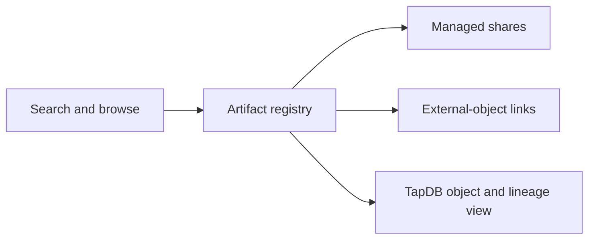

<p align="center">
  <strong>Dewey</strong><br>
  Artifact, reference, share, and external-object registry for Dayhoff.
</p>

<p align="center">
  <a href="docs/apis.md">API</a> ·
  <a href="docs/gui.md">GUI</a> ·
  <a href="docs/architecture.md">Architecture</a> ·
  <a href="docs/sequencer_run_registration.md">Run registration</a>
</p>

## Overview

Dewey is the LSMC artifact and reference registry. It tracks durable artifacts such as sequencing run directories, VCFs, reports, external objects, external-object relations, managed shares, and access routes. It is the registry layer for data products and referenceable outputs, not the laboratory material graph.

Dayhoff release inputs are maintained in its `services/pins.toml`. Dewey 12 retains TapDB **11.0.9**, auth **2.1.5**, and Python >=3.12. Each registered object, prefix or set has one EUID; each managed share has its own EUID and policy. Other services can persist these identities and resolve current metadata and delivery when needed.

The GUI centers on Library, S3 Browser, Sets, Sharing and Literature. Metadata and download permissions are independent; every share requires authentication. Prefix browsing is bounded and does not register descendants. Physical S3 deletion is prohibited. See the [Dewey 12 release ledger](docs/plans/20261026T010947Z_dewey_12_sharing_release_ledger.md) for source, validation, deployment and acceptance states.

Dewey management remains on approved networks. The scoped recipient ingress exposes authenticated fetch, report and recipient-account routes to external users.



## What It Does

| Capability | Current surface |
|---|---|
| Artifact registry | CLI, GUI search/details, and `/api/v1/*` artifact routes |
| Managed shares | Durable Dewey share records with short-lived access packages, revocation, and sanitized diagnostics |
| External objects | Cross-service object references and relation records |
| TapDB substrate | Generic object, lineage, audit, template, and external-link inspection at `/tapdb` |

## How It Works

Dewey writes registry objects and share state through explicit service config and TapDB-backed storage. Delivery URLs stay lazy and managed: active shares expose stable Dewey routes, while raw presigned URLs, object keys, and storage internals are not shown to unauthorized users. CLI, GUI, and API surfaces are alternate entrypoints over that same registry/share logic where the feature is implemented.

## Sharing

The **12.x contract** supports individual files, fixed selections and live recursive
prefixes. Named recipients can mix internal and external email addresses, including
people who have not registered. A creator must be allowed to delegate the selected
content; an authorized recipient needs no separate artifact ACL, S3 permission or
organization membership. There are **no anonymous shares**.

Choose **Named recipients** or **Public with registration**. Both require an active,
verified email through shared Login. New recipients receive share-only access;
their email domain does not admit them to an organization. The default lifetime is
30 days; explicit `expires_at: null` is indefinite. Personal download credentials
expire within 30 days and remain separately revocable.

| Operation | Dewey 12 behavior |
|---|---|
| Edit | Atomically change recipients, deadline, target membership and include/exclude filters using the current `policy_revision`; stale edits return conflict |
| Stable URLs | `/fetch/<share-euid>`; a single file resolves at the root, a single prefix preserves relative paths, and multiple targets use `<target-euid>/<relative-path>` |
| Friendly URLs | Claim a global lowercase ASCII slug of 3–63 letters/digits/hyphens; conflicts fail. Retired aliases remain tombstones and are never reassigned |
| File retrieval | Authenticated GET/HEAD, one byte range, conditional requests, MIME/filename metadata; unauthenticated machine clients receive 401 |
| Recursive retrieval | `?format=manifest` supplies complete paginated enumeration; CLI retrieves all pages with resume and partial-failure receipts |
| One-URL archive | `?format=tar` streams uncompressed TAR after completing inventory; changed/missing content aborts. TAR restarts; individual files resume |
| WWW reports | Declare `content_mode: www`, the HTML entrypoint and bundle root. A `/fetch/…/multiqc.html` URL initializes the isolated viewer; authorized CSS, JavaScript and data stay on per-context content hosts |
| Lifecycle audit | Authorized inventory and aggregate reports distinguish audiences, durations, age, last access, viewers, report assets, ranges, HEAD/304, archive outcomes and server bytes |
| Storage rebind | Compare destination content using qualified checksums, then revise the storage reference while retaining artifact/share identities and paths. No physical S3 move/delete occurs |

Create or edit from **Sharing**, copy the canonical or claimed-slug URL, and send an
invitation only when requested. To manage a known share directly, open
`/shares/<share-euid>`; Sharing search matches its name or purpose.
SES acceptance is recorded separately from failed
or uncertain submission; it does not establish mailbox delivery. Existing durable
`/shares/<share-euid>` links remain entrypoints. New raw S3 presigns are disabled;
obsolete delivery payloads fail explicitly.

MultiQC's **Export** toolbox can save generated plot images and data. If Chrome
asks to download multiple files, choose **Allow**, then click the download button
again. Reopen or refresh the report URL after a viewer update.

For curl/wget/CLI, sign in at `/recipient/account` and create a personal credential.
Keep it in a private file or environment, never in the durable URL. These
curl/wget examples use the caller's `DEWEY_TOKEN` and an actual persisted `SHARE_EUID`:

```bash
curl --fail -H "Authorization: Bearer ${DEWEY_TOKEN}" \
  "https://dewey.day.lsmc.bio/fetch/${SHARE_EUID}" -o artifact.bin
wget --header="Authorization: Bearer ${DEWEY_TOKEN}" \
  "https://dewey.day.lsmc.bio/fetch/${SHARE_EUID}?format=tar" -O collection.tar
```

The CLI requires an existing absolute-path credential file with mode 0600; it does
not read `DEWEY_TOKEN`. Configure its endpoint and private token file explicitly:

```bash
DEWEY_API_URL=https://dewey.day.lsmc.bio \
DEWEY_API_TOKEN_FILE=/absolute/private/token-file \
  dewey shares fetch "${SHARE_EUID}" --output ./collection --recursive --resume
```

Each request and each TAR member checks current policy. An admitted individual-file
response may finish; revocation blocks subsequent requests and archive members.
Already downloaded bytes and previously issued S3 presigns cannot be recalled.
Archive inventory is capped at one million objects/256 MiB of metadata; larger
collections fail explicitly before streaming and can use manifest/CLI retrieval.
Server response completion never claims the client saved the file.

See [Managed sharing](docs/sharing.md) for API/CLI details and
[release evidence](docs/plans/20261026T010947Z_dewey_12_sharing_release_ledger.md) for
the actual validation/deployment state. The original
[11.0.10 capabilities](docs/dev-docs/20261025_dewey_capabilities.md),
[requirements](docs/dev-docs/20261025_dewey_sharing_requirements.md) and
[gap analysis](docs/dev-docs/20261025_dewey_sharing_gap_analysis.md) retain the dated
baseline and requirement-by-requirement disposition.

## Quickstart

```bash
cd /Users/jmajor/projects/mega_dayhoff/repos_work/dewey
source ./activate <deploy-name>
dewey --help
dewey config init --help
dewey db lifecycle
dewey db verify-templates
dewey server start --port 8914
```

Use explicit absolute paths for service config and TapDB config. Do not document or depend on fallback config discovery.

## CLI Interface

The primary CLI is `dewey`. It covers config initialization, existing-template verification, server startup, artifact/reference operations, and operational utilities.

Common command families:

| Family | Purpose |
|---|---|
| `dewey config ...` | Create or inspect explicit runtime config. |
| `dewey db ...` | Verify existing Dewey templates or show native lifecycle guidance. |
| `dewey server ...` | Start the FastAPI service. |
| `dewey artifacts ...` | Register, resolve, and inspect artifact references where exposed by CLI. |
| `dewey shares ...` | Inspect managed shares through safe routes where exposed by CLI. |

Dewey delegates low-level storage lifecycle to `tapdb` and shared Cognito lifecycle to `daycog` only where Dewey explicitly documents that delegation. CLI, API, and GUI should expose the same registry/share capabilities wherever practical.

## GUI

Dewey exposes a browser GUI for artifact search, artifact/reference details, share management, external refs, and operational workflows. The mounted TapDB GUI at `/tapdb` is used for generic object, lineage, audit, template, and external-link inspection with explicit target configuration. DAG v2 is mounted at `/api/dag/v2/*`; `/api/dag/manifest` and `/obs_services` publish its successful mount contract.

GUI pages must not expose raw presigned URLs, bucket keys, or sensitive storage details to unauthorized users.

## API

The primary API is under `/api/v1/*`. Current route families include artifact registration/resolve, external objects, external-object relations, shares/share roots, search, QEO handoff, and observability.

Library, Sets and Sharing request `projection: "summary"` from
`POST /api/v1/registry/search`. This returns the complete authorized page of table
fields and visible member counts without expanding set members or external-object
details. The same search, filters, sorting, pagination and exact facet totals apply.
Omitting `projection`, or selecting `"full"`, retains the complete search response.
`GET /api/v1/records/{euid}` retains full record and visible member details. Unknown
projection values are rejected.

Health and observability routes follow the Dayhoff/Kahlo v3 shape: `/healthz`, `/readyz`, `/health`, `/obs_services`, `/api_health`, `/endpoint_health`, `/db_health`, `/my_health`, and `/auth_health`.

## Testing Info

The sharing release requires **at least 80% changed-line and changed-branch coverage**, measured separately for Dewey Python, browser JavaScript, Login, and selected release tooling. See the [coverage contract](docs/dev-docs/20261026_sharing_test_coverage.md) for scopes, baselines, failure-path coverage, and evidence. This is change-specific coverage, not whole-repository coverage.

Example focused checks, when explicitly authorized:

```bash
DEWEY_DEPLOYMENT_CODE=contract python -m pytest tests/test_share_management.py tests/test_share_grant_revision_envelope.py -q
```

Main/PR-only CI is configured to enforce the coverage gates; those workflows have not run during this release. Feature-branch pushes do not start full CI. Deployed sharing acceptance targets `https://dewey.day.lsmc.bio` with controlled fixtures and real authorized identities, including deep login, isolated report sidecars, machine retrieval, lifecycle changes, and audit reconciliation. Build provenance and user acceptance remain separate receipts.

## Technical Details, History, And Linkouts

- [`docs/README.md`](docs/README.md): Dewey docs index.
- [`docs/apis.md`](docs/apis.md): HTTP routes and auth modes.
- [`docs/gui.md`](docs/gui.md): browser surfaces.
- [`docs/sharing.md`](docs/sharing.md): authenticated internal/external sharing, current recipient grants, stable fetch URLs, isolated reports, and preserving conversion. Deployment status is tracked in the linked implementation ledger.
- [`docs/architecture.md`](docs/architecture.md): domain ownership and runtime model.
- [`docs/sequencer_run_registration.md`](docs/sequencer_run_registration.md): run-directory registration.
- [`docs/qeo/`](docs/qeo/): QEO/Dewey handoff contracts.
- [`docs/old_docs/`](docs/old_docs/): historical material only.

## Deletion policy

Dewey GUI and API deletion are disabled for all users, including administrators
and service principals. DELETE requests, S3 deletion review/execution, registration
archiving, artifact-set member removal, upload abort, and existing-object replacement
are prohibited. Existing deletion previews cannot be executed. The embedded TapDB
browser is read-only, including generic edits and backup restoration, to prevent
deleting data through a secondary surface. New registrations, registry metadata
edits, uploads to new keys, downloads, and sharing remain available. Revoking shares
or tokens retains their records and remains available as an access-security control.
The prohibition has no configuration switch or administrator exemption.
