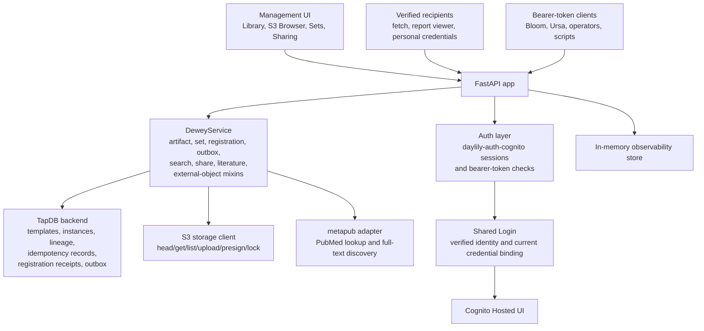

# Dewey Architecture

## Summary

Dewey is the canonical artifact registry and artifact-resolution service in the Daylily stack. Its job is not to run workflows or own every domain object. Its job is to answer a narrower set of questions well:

Dewey's authentication integration uses `daylily-auth-cognito` 2.x: browser sessions live in `browser.session`, Hosted UI helpers live in `browser.oauth` and `browser.google`, bearer verification lives in `runtime.verifier` and `runtime.m2m`, and Cognito lifecycle changes stay in `daycog` via `admin.*`. The day deployment uses shared Login as its external broker. Service runtime code must not import `daylily_auth_cognito.cli`.

- what artifact exists
- what its stable Dewey identity is
- where the bytes live
- how that artifact is grouped, shared, and cross-linked
- what literature records have been saved into Dewey

## Domain Model

The current domain model is visible in the FastAPI surface, service layer, and TapDB template usage.

### Artifact

An artifact record currently carries:

- `artifact_euid`
- `artifact_type`
- storage coordinates such as backend, bucket, key, version, and derived `storage_uri`
- origin metadata such as `producer_system` and `producer_object_euid`
- lifecycle fields such as `storage_status`, `availability_status`, and retention metadata
- freeform `metadata`

The current browser accepts name, description and arbitrary JSON metadata through
key/value and advanced JSON editors. Producer-specific fields such as sample,
study, assay and pipeline metadata remain conventions or explicit producer API
contracts; they are not a fixed browser metadata schema.

### Artifact Set

Artifact sets are Dewey-owned groupings with explicit native membership lineage,
name/description and arbitrary metadata. The browser selects existing Object and
Prefix EUIDs. Producer registration APIs retain their typed set and manifest
contracts; ordinary set edits do not redefine those producer receipts. Set member
removal and registry archiving remain blocked by the deletion policy; removing
a share target changes access without removing a registry relationship or bytes.

### Managed Share

A schema-3 share has a stable native share EUID, owner, audience, content mode,
current policy revision and expiry. Typed TapDB lineage connects the share to
immutable scope revisions, their artifact targets, recipient grants, aliases and
audit events. Recipient or target removal preserves prior revisions and events.

- Object and fixed-set selections coexist with live prefixes whose future matching descendants are included.
- Named recipients may mix internal/external addresses and pending accounts. Public with registration admits any current verified registered identity. Neither audience admits anonymous access.
- The creator needs delegation authority. A valid recipient grant supplies access without an independent artifact ACL, S3 permission or organization membership.
- Omitted expiry means 30 days; explicit `null` means indefinite. Atomic edits require the current `policy_revision`; stale writes conflict.
- `/fetch/<share-euid>` and claimed slugs resolve the same policy. Global slug claims are unique and remain permanent tombstones after retirement.
- Authenticated gateway delivery supports files, paginated manifests and uncompressed TAR after complete inventory. Managed raw S3 presigns and old transport payloads are rejected.
- WWW mode declares an HTML entrypoint and bundle root. The durable fetch URL initializes an isolated content host; authorized sidecars are checked individually.

See [Managed sharing](sharing.md) for exact fields, path layout, limits and
credential acquisition. Share-only onboarding grants no automatic organization
membership. Personal credentials expire independently of the share.

### Storage Location Revision

An explicit location rebind retains the artifact EUID and stable share paths only
after qualified content-equivalence and collision checks. Current location
revision is an optimistic concurrency fence; native history records the change.
Rebind moves a reference, not S3 bytes, and does not delete storage objects.

### External Object And Relation

External objects let Dewey model links to records owned elsewhere, such as Atlas documents or other system-specific IDs. External-object relations attach those records to artifacts or artifact sets without turning Dewey into the semantic owner of the external system.

### Literature Save Overlay

Literature records are represented as artifacts with `artifact_type == "literature"`, then enriched by a separate literature-save layer that stores:

- owner subject
- visibility scope
- allowed users
- allowed groups
- saved-by-me and saved-by-others projections used in search and the literature UI

## Runtime Shape

The current application boot path lives in `dewey_service.app:create_app`.

At startup, Dewey wires together:

- FastAPI app and route surface
- a `DeweyService` composed from artifact, artifact-set, QEO/KEO registration, outbox, search, literature, sharing, and external-object mixins
- a TapDB backend for persistence
- an S3 storage client for object inspection, upload sessions, authenticated delivery, locking, and independently authorized storage access
- a `MetapubAdapter` for PubMed search and record retrieval when available
- a Cognito web-session config via `daylily-auth-cognito`
- an in-memory observability store for request, DB, and auth rollups

## HTTP And Browser Surfaces

Internet reachability is restricted to the configured recipient/authentication
routes and isolated content hosts. The day deployment uses a dedicated ALB and
restricted private origin listeners 8443/8444. Management, admin, embedded TapDB,
service backchannels and sibling services retain their trusted-network boundary.
An endpoint with no application-auth requirement is not necessarily public ingress.

### Browser UI

The current GUI is split across these main pages:

- `/ui`
- `/storage`
- `/sets`
- `/shares` and `/shares/<share-euid>` for management
- `/records/<artifact-or-set-euid>`
- `/add` (`/artifacts` also opens Add)
- `/literature`
- `/search` (the Library)
- `/ui/anomalies`
- `/ui/observability`
- `/admin`

Recipient pages use `/fetch/<share-euid-or-slug>[/<path>]` and
`/recipient/account`. They do not expose the management library.

### HTTP API

The API surface is grouped into:

- health and observability endpoints
- artifacts
- artifact sets
- managed shares
- resolution endpoints
- literature endpoints
- search endpoints
- external objects and relations

Create operations use `Idempotency-Key` where declared. Share edits/revocations
use explicit policy revisions; storage rebind uses an explicit location revision.
Do not infer replay safety for an invitation or lifecycle operation from its HTTP method.

## Auth Model

The current auth split is explicit in code:

- session-or-bearer principals for the current EUID registry; older service APIs retain their declared bearer requirements
- shared Login-backed browser sessions on day, with direct Cognito mode available only when explicitly configured
- verified-email identity and verified ingress for managed sharing; recipient-only identities are restricted to recipient routes
- current broker/provider identity checks and finite, separately revocable personal credentials
- either bearer token or valid session for most observability endpoints
- session-only access for `/my_health`
- admin-session requirement for `/admin`

Current role values are:

- `READ_ONLY`
- `READ_WRITE`
- `ADMIN`

Current default Cognito group mappings are:

- `platform-admin -> ADMIN`
- `dewey-admin -> ADMIN`
- `dewey-readwrite -> READ_WRITE`
- `dewey-readonly -> READ_ONLY`

## Storage Behavior

Dewey is designed for artifacts that already live in S3, but current code also supports direct upload and URL-backed download behavior through the GUI and API.

Implemented storage behaviors include:

- register an existing S3 object
- import from `s3://` URI in `reference` or `copy` mode
- expand S3 prefixes
- create upload sessions for managed storage
- complete uploads into managed storage
- verify artifact storage
- apply retention locks
- retain independently authorized storage access; a share-only right cannot issue raw presigns
- stream share files with HEAD/range/conditional semantics, paginated manifests and complete-inventory TAR delivery
- verify equivalent storage destinations before changing an artifact's location reference

This is broader than a pure metadata catalog, but it is still bounded by artifact ownership, not end-to-end workflow ownership.

## Search Behavior

Current search is split between:

- the Library for authorized artifact records, Sets for selections and Sharing for managed shares
- Add and the S3 Browser for registration/upload workflows

Implemented service search behavior includes:

- text query over names, IDs, metadata, storage URIs, literature fields, and external-object projections
- property filters over fields and nested metadata
- created-at range filters
- JSON and TSV export

## Observability

Dewey also ships service-local observability features:

- `/healthz` and `/readyz`
- authenticated health rollups under `/health`, `/obs_services`, `/api_health`, `/endpoint_health`, `/db_health`, `/my_health`, and `/auth_health`
- local anomaly records exposed through API and UI views

These are Dewey-local operational views, not a general platform observability backend.

## Ownership Boundaries

### What Dewey Owns

Current Dewey ownership aligns with the adjacent Dayhoff governance docs:

- artifact identity
- artifact registration
- artifact grouping
- artifact registry metadata
- artifact lookup and resolution

### What Dewey Does Not Own

Current code and docs do not support claims that Dewey owns:

- workflow orchestration
- wet-lab truth
- analysis truth
- customer release authority
- a public messaging/event API

The QEO/KEO registration path adds a local transactional outbox for internal
handoff evidence. It is persisted in TapDB and is not exposed as a public event
stream.

### Relation To Other Services

- Bloom can produce artifacts and register them with Dewey, but Bloom is not the artifact registry.
- Ursa can resolve and register analysis artifacts, but Ursa is not the artifact registry.
- Atlas can consume Dewey artifact references, but Atlas is not the artifact registry.
- TapDB persists Dewey objects, but TapDB is not the semantic owner.
- Dayhoff deploys and wires Dewey into the stack, but Dayhoff does not own Dewey's domain behavior.

## Audit And Evidence Boundary

Native events record lifecycle changes, authorization decisions and server
delivery outcomes. Resolution denials for known canonical shares commit before
returning 403; unknown identifiers and retired aliases do not fabricate native
share relationships. Aggregate reports distinguish authorization evaluations,
successful file responses, report entries/assets, archive outcomes and bytes.
Server completion is not proof that a client saved the file. Complete inventory
exports bind an observation time and inventory digest across pages.

This guide describes the 12.0.8 source contract. Release provenance, changed-code
coverage and live acceptance have separate receipts in the
[execution ledger](plans/20261026T010947Z_dewey_12_sharing_release_ledger.md).
Internal signup is confirmed; internal application admission/scoped-access proof
and final user acceptance remain open. Historical test totals are not current
validation evidence.
