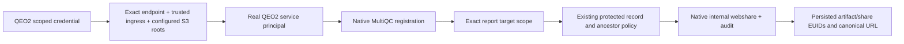

# QEO2 scoped internal MultiQC source capability

## Current continuation state

Status: Dewey **12.0.33** /54eeffa705feed1712533c9957a8865ac013e933 DEPLOYED. Native EC2 build exit0 (22:48:39–22:51:19Z); final image sha256:9f3326730d5984a2e639965bffa521be337fa6199fe7fe69910bf30421716169. Native Dewey-only Compose Healthy/exit0 at22:52:04Z. QEO2 **2.0.16** /b32fb67421ec177d7ce4921a76e2cc2af8644101 deployed. Its scoped client uses existing private management listener10.0.0.222:8444, canonical Host and TLS validation. No Apache policy change. Dedicated credential unchanged. Allowed S3 roots use native YAML /home/ubuntu/dewey-qeo2-source-12.0.33/dewey-config.yaml. Complete exact existing registrations are reused; absent/incomplete registrations use the native importer. More than one version requires explicit artifact EUID.

Repo /Users/jmajor/projects/dewey-registration-pool-20261108, branch codex/qeo2-internal-multiqc-20261109; annotated tag12.0.33 and branch published. Host i-07df3a933e4839f52,us-west-2; interactive ubuntu SSM session54927. Native release receipt /home/ubuntu/dewey-qeo2-source-12.0.33.result. QEO source batch /opt/qeo2/day/receipts/reinterpret-2.0.16-remaining10.log/.exit;All17 selected source revisions complete,12,610 production observations; final remaining10 native batch exit0. Browser3D handoff complete. QEO2 final axis-caption update2.0.17 is deploying separately. Next commit this completed Dewey capability ledger; QEO owns final browser and Linear handoff. No purge, original-QEO changes, tests/CI/PR/merge, local builds or secondary probes. Earlier actual failures remain documented below.

User authority: explicitly answered “Add scoped QEO2 service support” to the 403 service-account sharing restriction. Scope: one new QEO2 credential/endpoint for MultiQC report registration and internal webshare creation. This supersedes the earlier QEO2-only deployment boundary only for this Dewey capability. No purge, broad service API grant, human impersonation, global sharing-policy relaxation, recipients emails, or source search. Existing resolver credential remains read-only.

Endpoint POST /api/v1/qeo/report-source requires its own hash/expiry credential, native trusted-tailnet ingress, and a source in configured production roots. It establishes a real READ_WRITE service principal. Native MultiQC registration/lineage is required. A request-local exact report scope allows share delegation only for nonrestricted internal-download policy; protected target/ancestor controls remain in native record_clause. Existing single-report webshare lookup uses current revision lineage. Generic routes cannot obtain this scope. Human verified-email requirement remains unchanged outside this operation.

New webshares have exact lsmc.com and lsmc.bio domain recipients, native service lifetime14 days, no user emails. Existing eligible webshare reused; revoked/expired native idempotency is not automatically revived. All writes retain native service attribution and share events. New credential cannot become a generic registry token even if misconfigured in api_tokens.

The selected17 source revisions and final user handoff are tracked in /Users/jmajor/Documents/ChatGPT/QEO/docs/plans/20261109T061500Z_qeo_requirements_extraction_ledger.md. Trust native results; no secondary probes.

## Gate 0

Native container inventory: dayhoff-day-dewey-1 release12.0.29 revision886b5cdeb70bb3e1769c51d43c8463fa59885f8c; image108782052779.dkr.ecr.us-west-2.amazonaws.com/dayhoff/day/dewey@sha256:2b24a82aa35c5351d04a12875eb738b4f18553ab29cd5eca563dee9316544297. Ordinary service-token GET of a known source share returned403: managed sharing requires verified ingress/current verified-email identity. No writes attempted through that rejected path. Source environment activated successfully. Source review only, no tests or compilation.

## Native operation receipts / correction

12.0.30 native build exit0 (22:15:47–22:18:48Z), image sha256:6038f5aca90094bb0b2b681cbd718bdac7132f5263126861143c0869ddf8b698. Compose Healthy/exit0 at22:20:04Z. First real import exposed startup failure; native status was trusted until that failure. No additional success gate was added. Credential helper first needed the image application user, then explicit DEWEY_DEPLOYMENT_CODE=day; native credential issuance and private docker cp succeeded. Deployment uses targeted sudo for protected Compose/manifest files. Existing credential retained for12.0.31; no extra credential issuance.

12.0.31 / 58473c0a07110c05bcdd2ff037f0ff16a4460966 native EC2 build exit0, 22:21:33–22:24:05Z. Image sha256:29713f5404aaf0c15cd67e36f07bc5fecd92106e3dbda47749d7aa01b1796073. Native12.0.30 credential receipt copied into12.0.31 workdir for deployment; credential remains unchanged.

12.0.31 deployed exit0 at22:24:39Z; initial environment-form setting caused EnvSettingsSource parse failure. Corrected configuration to native YAML list, removed environment override, recreated Dewey-only; Compose Healthy. First real request then403 ingress, triggering QEO2 transport correction instead of weakening sharing controls.

##12.0.32 source response correction

Private management ingress succeeded. First native operation took172.476seconds and returned400 because the new endpoint passed the compact artifact response into saved_bundle; that API deliberately omits report_bundle. Native registration succeeded, but no QEO revision was written. Reissuing the same native idempotent request returned the exact error quickly. Move the required MultiQC type/bundle check into the already-required record policy query using its full payload. No extra readback or generic API behavior change. QEO2 removes its prematurely shorter120-second client timeout and waits for the owning service result. Native source policy remains unchanged.

12.0.32 / 06264ada7d5898b45e68b534e831e6bb187573c1 published; final native build tmux dewey-qeo2-source-12-0-32. Result /home/ubuntu/dewey-qeo2-source-12.0.32.result. Next copy existing source-credential.json receipt from12.0.31 workdir then targeted sudo helper deploy. Helper now writes allowed-root list into selected native YAML with prior config permissions.

12.0.32 native build exit0 (22:33:09–22:35:48Z), image sha256:91be3df8d3e58fc3fe3fdf271e4e8b674dff62622c0350634fef23588ca05f1c. Native selected-service Compose Healthy/exit0 at22:36:27Z. QEO2 first2 source revisions completed through scoped service, demonstrating actual required registration/share intake. Remaining15 follow same exact selected batch; no generic access expansion.

##12.0.33 reuse existing owning registration

Seven QEO revisions completed. November5 Bjuice source-URI registration then returned native403 This S3 path requires independent access or an exact share-scoped operation. Source intake was always invoking import even for already-complete registered reports. Source resolution now uses exact storage URI and native registry visibility, reuses the persisted complete registration, and invokes import only when registration is absent/incomplete. More than one registered version requires an explicit artifact EUID. The existing download/share/protected-ancestor policy query remains unchanged. No S3 re-read or registration replay is added over an existing owning result; no access grant or override. QEO2 remains2.0.16; native batch halted after7, remaining10 pending.

## Final release result · 12.0.33

Native EC2 build exit0 and selected-service Compose Healthy/exit0. The two November Bjuice imports now completed through existing registration reuse and native webshare policy. The scoped capability is deployed and consumed by QEO2. Original human verified-email authorization remains unchanged; no broad service token delegation. Source continuation and final receipt are owned by the QEO ledger.

Selected-source refresh complete:17 report revisions,12,610 observations,zero missing applicable run/date bindings. Fourteen controller root names supplied;three October delivery-only roots unavailable;no controller EUID supplied/invented. Existing QEO evidence/frozen results retained without purge. QEO receipt /Users/jmajor/Documents/ChatGPT/QEO/docs/plans/20261109T072500Z_qeo2_implementation/source-revisions-2.0.16-completion.json. This scoped Dewey implementation/deployment is complete; broader QEO acceptance is not asserted.
