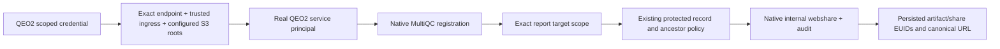

# QEO2 scoped internal MultiQC source capability

## Current continuation state

Status: implementation complete, final release/build/deploy pending. Repo /Users/jmajor/projects/dewey-registration-pool-20261108; clean baseline715d010 (deployment docs after live12.0.29/886b5cd), branch codex/qeo2-internal-multiqc-20261109. Planned annotated12.0.30. Production host i-07df3a933e4839f52 us-west-2, interactive ubuntu SSM session76985. Native selected-service build helper in this directory; final EC2 build only. No tests/lint/CI/PR/merge or sibling changes.

User authority: explicitly answered “Add scoped QEO2 service support” to the 403 service-account sharing restriction. Scope: one new QEO2 credential/endpoint for MultiQC report registration and internal webshare creation. This supersedes the earlier QEO2-only deployment boundary only for this Dewey capability. No purge, broad service API grant, human impersonation, global sharing-policy relaxation, recipients emails, or source search. Existing resolver credential remains read-only.

Endpoint POST /api/v1/qeo/report-source requires its own hash/expiry credential, native trusted-tailnet ingress, and a source in configured production roots. It establishes a real READ_WRITE service principal. Native MultiQC registration/lineage is required. A request-local exact report scope allows share delegation only for nonrestricted internal-download policy; protected target/ancestor controls remain in native record_clause. Existing single-report webshare lookup uses current revision lineage. Generic routes cannot obtain this scope. Human verified-email requirement remains unchanged outside this operation.

New webshares have exact lsmc.com and lsmc.bio domain recipients, native service lifetime14 days, no user emails. Existing eligible webshare reused; revoked/expired native idempotency is not automatically revived. All writes retain native service attribution and share events. New credential cannot become a generic registry token even if misconfigured in api_tokens.

Next: tag/publish12.0.30 with skip-ci commit, native EC2 build, issue credential via new native dewey qeo source-credential-create, deploy Dewey-only Compose. Then QEO2 2.0.14 build/deploy and 17 source revisions tracked in /Users/jmajor/Documents/ChatGPT/QEO/docs/plans/20261109T061500Z_qeo_requirements_extraction_ledger.md. Trust native results; no secondary probes.

## Gate 0

Native container inventory: dayhoff-day-dewey-1 release12.0.29 revision886b5cdeb70bb3e1769c51d43c8463fa59885f8c; image108782052779.dkr.ecr.us-west-2.amazonaws.com/dayhoff/day/dewey@sha256:2b24a82aa35c5351d04a12875eb738b4f18553ab29cd5eca563dee9316544297. Ordinary service-token GET of a known source share returned403: managed sharing requires verified ingress/current verified-email identity. No writes attempted through that rejected path. Source environment activated successfully. Source review only, no tests or compilation.

