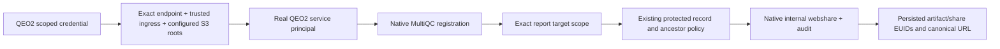

# QEO2 scoped internal MultiQC source capability

## Current continuation state

Status: 12.0.30 built/deployed, then first actual QEO import returned503. Native Dewey traceback: qeo_source_s3_roots environment string lacked native list normalization. Restoring only Dewey to12.0.29 using captured baseline. QEO2 remains2.0.14; no import succeeded. Corrected12.0.31 extends existing string-list parser and uses its comma-delimited format. Final EC2 build/deploy pending; no tests/CI/PR/merge. Repo /Users/jmajor/projects/dewey-registration-pool-20261108, branch codex/qeo2-internal-multiqc-20261109; host i-07df3a933e4839f52, interactive ubuntu session76985.

User authority: explicitly answered “Add scoped QEO2 service support” to the 403 service-account sharing restriction. Scope: one new QEO2 credential/endpoint for MultiQC report registration and internal webshare creation. This supersedes the earlier QEO2-only deployment boundary only for this Dewey capability. No purge, broad service API grant, human impersonation, global sharing-policy relaxation, recipients emails, or source search. Existing resolver credential remains read-only.

Endpoint POST /api/v1/qeo/report-source requires its own hash/expiry credential, native trusted-tailnet ingress, and a source in configured production roots. It establishes a real READ_WRITE service principal. Native MultiQC registration/lineage is required. A request-local exact report scope allows share delegation only for nonrestricted internal-download policy; protected target/ancestor controls remain in native record_clause. Existing single-report webshare lookup uses current revision lineage. Generic routes cannot obtain this scope. Human verified-email requirement remains unchanged outside this operation.

New webshares have exact lsmc.com and lsmc.bio domain recipients, native service lifetime14 days, no user emails. Existing eligible webshare reused; revoked/expired native idempotency is not automatically revived. All writes retain native service attribution and share events. New credential cannot become a generic registry token even if misconfigured in api_tokens.

Next: consume native build result /home/ubuntu/dewey-qeo2-source-12.0.30.result, issue credential via new native dewey qeo source-credential-create, deploy Dewey-only Compose. Then QEO2 2.0.14 build/deploy and 17 source revisions tracked in /Users/jmajor/Documents/ChatGPT/QEO/docs/plans/20261109T061500Z_qeo_requirements_extraction_ledger.md. Trust native results; no secondary probes.

## Gate 0

Native container inventory: dayhoff-day-dewey-1 release12.0.29 revision886b5cdeb70bb3e1769c51d43c8463fa59885f8c; image108782052779.dkr.ecr.us-west-2.amazonaws.com/dayhoff/day/dewey@sha256:2b24a82aa35c5351d04a12875eb738b4f18553ab29cd5eca563dee9316544297. Ordinary service-token GET of a known source share returned403: managed sharing requires verified ingress/current verified-email identity. No writes attempted through that rejected path. Source environment activated successfully. Source review only, no tests or compilation.

## Native operation receipts / correction

12.0.30 native build exit0 (22:15:47–22:18:48Z), image sha256:6038f5aca90094bb0b2b681cbd718bdac7132f5263126861143c0869ddf8b698. Compose Healthy/exit0 at22:20:04Z. First real import exposed startup failure; native status was trusted until that failure. No additional success gate was added. Credential helper first needed the image application user, then explicit DEWEY_DEPLOYMENT_CODE=day; native credential issuance and private docker cp succeeded. Deployment uses targeted sudo for protected Compose/manifest files. Existing credential retained for12.0.31; no extra credential issuance.
